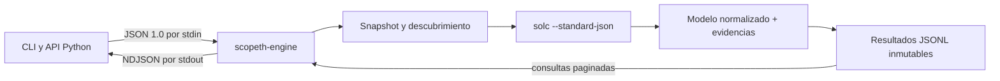

<div align="center">
	<div>░██████╗░█████╗░░█████╗░██████╗░███████╗████████╗██╗░░██╗</div>
	<div>██╔════╝██╔══██╗██╔══██╗██╔══██╗██╔════╝╚══██╔══╝██║░░██║</div>
	<div>╚█████╗░██║░░╚═╝██║░░██║██████╔╝█████╗░░░░░██║░░░███████║</div>
	<div>░╚═══██╗██║░░██╗██║░░██║██╔═══╝░██╔══╝░░░░░██║░░░██╔══██║</div>
	<div>██████╔╝╚█████╔╝╚█████╔╝██║░░░░░███████╗░░░██║░░░██║░░██║</div>
	<div>╚═════╝░░╚════╝░░╚════╝░╚═╝░░░░░╚══════╝░░░╚═╝░░░╚═╝░░╚═╝</div>
</div>

<br/>

<p align="center">
  <strong>👹 Enumeración profunda y trazable de código Solidity 👹</strong><br>
</p>

<p align="center">
  <a href="https://github.com/Roger08G/scopeth/actions/workflows/ci.yml"></a>
  <a href="https://github.com/Roger08G/scopeth/releases"></a>
  <a href="https://github.com/Roger08G/scopeth/stargazers"></a>
  <a href="https://github.com/Roger08G/scopeth/network/members"></a>
  
  
  
  <a href="LICENSE"></a>
  <a href=".github/dependabot.yml"></a>
</p>

Scopeth combina un motor Go con una CLI y API Python para convertir fuentes Solidity
en un inventario semántico consultable. Trabaja localmente, conserva la procedencia
de cada conclusión y produce resultados deterministas preparados para revisión y
automatización.

> [!IMPORTANT]
> Scopeth **no explota contratos ni asigna severidades**. Sus observaciones señalan
> superficies de revisión y deben contrastarse con análisis manual, contexto del
> protocolo y estado on-chain cuando corresponda.

## Índice

- [Qué entrega hoy](#qué-entrega-hoy)
- [Arquitectura](#arquitectura)
- [Requisitos comprobados](#requisitos-comprobados)
- [Instalación y build](#instalación-y-build)
- [Uso](#uso)
- [API Python](#api-python)
- [Resultados](#resultados)
- [Validación](#validación)
- [Límites importantes](#límites-importantes)
- [Documentación](#documentación)
- [Contribuir](#contribuir)
- [Seguridad](#seguridad)
- [Licencia](#licencia)

## Qué entrega hoy

- Entrada desde un `.sol`, directorio, Standard JSON, build-info o manifiesto Sourceth `schema_version: 1`.
- Snapshot estable con límites, hashes SHA-256 y rechazo de symlinks, traversal y URLs remotas.
- Modos `semantic`, `syntax` y `auto`, con degradación explícita y código de salida `3` para resultados parciales.
- Contratos, interfaces, librerías, funciones, getters generados, variables, modifiers, eventos y errores.
- Imports, herencia, llamadas, lecturas/escrituras directas, `require`, `assert`, ramas con `revert` y presencia de assembly.
- Aliases locales y parámetros `storage` con rutas simbólicas precisas, por ejemplo `accounts[msg.sender].balance`.
- Resúmenes directos/transitivos de estado, guards, llamadas y activos mediante punto fijo por SCC, incluida recursión.
- Propagación de la unión de efectos de modifiers resueltos, con degradación explícita a `unknown` cuando falta un binding.
- IR persistida (`Read`, `Write`, `ReadWrite`, `Branch`, `InternalCall`, `ModifierCall`, llamadas externas, `Emit`, `Revert`, `ValueOperation` y `UnknownEffect`).
- Movimientos nativos, creación con valor, `selfdestruct`, ERC-20/721/1155, ERC-4626, wrapped native y autorizaciones, manteniendo separados movimiento, permiso y contabilidad.
- Cantidades y unidades simbólicas, dependencias, retorno comprobado/propagado, callbacks, guards, entradas alcanzables y estado relacionado.
- Cambios de propietarios, roles, tesorería, oráculo, fees, pausas y proxies con actor simbólico y evidencia.
- Superficies de revisión sin severidad: interacciones externas, escritura posterior, destinos dinámicos, bucles, aritmética, conversiones, oráculos, composición y assembly Yul seleccionado.
- Resultados JSON/JSONL inmutables, informe Markdown y consultas paginadas ejecutadas en Go.
- Caché de compilación por hashes de fuentes, rutas lógicas, remappings e identidad SHA-256 de `solc`; `--refresh` permite omitirla.
- Perfiles CPU/heap opcionales compatibles con `go tool pprof`, escritos a archivos nuevos y sin servidor HTTP.
- Protocolo JSON/NDJSON `1.0`: progreso por `stderr` en el CLI y salida JSON limpia por `stdout`.

## Arquitectura



El AST de `solc` es una entrada interna; la API pública utiliza entidades propias e IDs deterministas. Cada conclusión registra `evidence_kind` (`compiler_fact`, `derived` o `heuristic`) y `resolution` (`resolved`, `partial` o `unknown`).

## Requisitos comprobados

| Componente | Versión validada |
|---|---|
| Go | 1.27.1 (`windows/amd64`) |
| Python | 3.12.14, 3.13.15 y 3.14.6 |
| uv | 0.12.15 |
| Solidity | 0.8.37 (`Windows.msvc`) |

Scopeth prioriza Solidity `0.8.x`. Un pragma expresa compatibilidad, no demuestra qué compilador produjo un despliegue. Si un build-info declara otra versión, el manifiesto marca el resultado como `analysis_only`.

## Instalación y build

Instala Go, Python, uv y un binario `solc` de una fuente confiable. Después:

### Windows PowerShell

```powershell
git clone https://github.com/Roger08G/scopeth.git
cd scopeth
.\scripts\build.ps1
$env:SCOPETH_ENGINE = (Resolve-Path .\bin\scopeth-engine.exe)
uv run --project .\python scopeth doctor --solc "C:\ruta\confiable\solc.exe"
```

### Linux / macOS

```bash
git clone https://github.com/Roger08G/scopeth.git
cd scopeth
./scripts/build.sh
export SCOPETH_ENGINE="$PWD/bin/scopeth-engine"
uv run --project python scopeth doctor --solc /ruta/confiable/solc
```

`doctor` no usa la red. `analyze` tampoco instala ni descarga compiladores.

## Uso

```powershell
uv run --project .\python scopeth analyze .\contracts `
  --mode auto `
  --profile deep `
  --output .\analysis `
  --solc "C:\tools\solc.exe" `
  --jobs 4 `
  --refresh
```

Para medir el motor, añade `--cpu-profile .\benchmarks\cpu.prof` y/o `--heap-profile .\benchmarks\heap.prof`. Las rutas existentes no se sobrescriben.

El resultado queda en `analysis/RUN_ID/`. Consultas:

```powershell
uv run --project .\python scopeth functions .\analysis\RUN_ID --visibility external --payable
uv run --project .\python scopeth flows .\analysis\RUN_ID --asset-class erc20 --operation transfer --json
uv run --project .\python scopeth surfaces .\analysis\RUN_ID --category external_interaction
uv run --project .\python scopeth configuration .\analysis\RUN_ID --category proxy
uv run --project .\python scopeth explain .\analysis\RUN_ID --symbol "src/Vault.sol:Vault.withdraw(uint256)"
uv run --project .\python scopeth state .\analysis\RUN_ID --written-by "src/Vault.sol:Vault.withdraw(uint256)"
uv run --project .\python scopeth graph .\analysis\RUN_ID --kind calls --depth 4 --format mermaid
uv run --project .\python scopeth graph .\analysis\RUN_ID --kind assets --format json --json
```

Para un manifiesto real de Sourceth:

```powershell
uv run --project .\python scopeth analyze `
  --sourceth-manifest .\download\manifest.json `
  --output .\analysis `
  --solc "C:\tools\solc.exe"
```

## API Python

```python
from pathlib import Path

from scopeth import AnalyzeOptions, Scopeth

client = Scopeth(engine=Path("bin/scopeth-engine.exe"))
result = client.analyze(
    Path("contracts"),
    AnalyzeOptions(mode="semantic", output=Path("analysis"), solc=Path("tools/solc.exe")),
)

for function in client.functions(result.run_dir, visibility="external"):
    print(function["symbol"])
```

Los iteradores de consulta consumen registros conforme llegan; no cargan el conjunto completo en la API.

## Resultados

```text
analysis/RUN_ID/
├── manifest.json
├── summary.json
├── symbols.jsonl
├── calls.jsonl
├── state-accesses.jsonl
├── storage-aliases.jsonl
├── guards.jsonl
├── asset-operations.jsonl
├── configuration-changes.jsonl
├── assembly-operations.jsonl
├── observations.jsonl
├── evidence.jsonl
├── edges.jsonl
├── summaries.jsonl
├── ir.jsonl
└── report.md
```

Cada ejecución se publica mediante staging y renombrado atómico. Un resultado anterior nunca se sobrescribe. Consulta el [informe de ejemplo](examples/example-report.md).

## Validación

```powershell
.\scripts\validate.ps1 -Solc "C:\ruta\confiable\solc.exe"
```

La validación ejecuta tests Go, `go vet`, Ruff, formato, mypy, pytest, build de ambos componentes y una integración real con `solc`.

## Límites importantes

- No reconstruye transacciones ejecutadas, balances, claves de mappings ni direcciones reales sin datos on-chain.
- Una llamada posible no demuestra que una ruta se haya ejecutado; `payable` tampoco demuestra recepción de fondos.
- Una interfaz externa no identifica la implementación desplegada en una dirección.
- Assembly enumera `sload/sstore`, `tload/tstore`, llamadas, creación, `selfdestruct`, logs y control de flujo seleccionados; no resuelve semánticamente todos sus argumentos o efectos.
- Los resúmenes transitivos cruzan llamadas internas y modifiers resueltos; no atribuyen efectos de una interfaz externa a una implementación concreta.
- Los efectos de un modifier se unen al resumen de la función, pero F3 no modela el orden de ejecución ni la multiplicidad de `_`; eso requiere un CFG completo.
- Un alias o binding sin referencia semántica suficiente se conserva como `unknown`; nunca se interpreta como ausencia de efectos.
- No es un detector de vulnerabilidades ni emite severidades. Las observaciones son superficies de revisión.
- Un proceso separado no constituye un sandbox del sistema operativo; consulta [seguridad y limitaciones](docs/security-and-limitations.md).

## Documentación

- [Arquitectura y pases](docs/architecture.md)
- [Protocolo Python ↔ Go](docs/protocol.md)
- [Compatibilidad comprobada](docs/compatibility.md)
- [Integración con Sourceth](docs/sourceth.md)
- [Seguridad local y limitaciones](docs/security-and-limitations.md)
- [Benchmarks reproducibles](benchmarks/README.md)

## Contribuir

Las contribuciones deben mantener el análisis local, determinista y respaldado por
evidencia. Consulta [CONTRIBUTING.md](CONTRIBUTING.md) para preparar el entorno,
ejecutar los quality gates y abrir un pull request acotado.

## Seguridad

No publiques vulnerabilidades del propio Scopeth en incidencias abiertas. Sigue el
proceso de divulgación privada descrito en [SECURITY.md](SECURITY.md).

## Licencia

MIT. Consulta [LICENSE](LICENSE).
